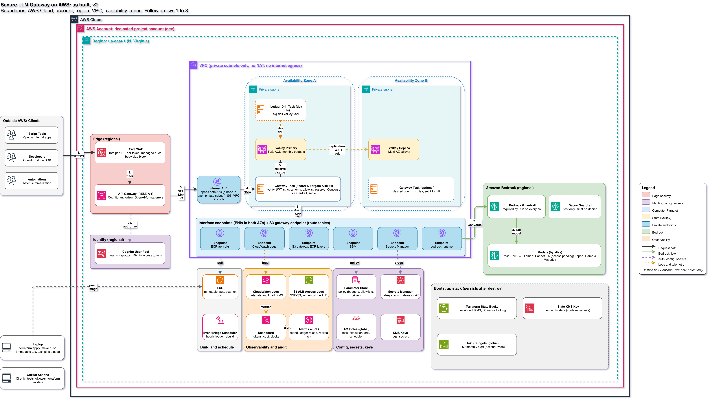

# Secure LLM Gateway on AWS

One private front door for every internal app and developer that uses large language models.
It decides who can use which model, how much they can spend, and what gets screened and recorded.



Step by step: [how a request flows](docs/architecture/README.md#how-a-request-flows).

## The problems this solves

When a company starts using AI, the same problems show up within weeks:

- **Keys everywhere.** Each team gets its own provider API key. Keys get copied into scripts,
  pasted into chats, and never rotated. When someone leaves, nobody knows which keys they had.
- **Runaway spend.** One buggy loop or one curious engineer can burn through a month's budget
  in an afternoon, and nobody finds out until the bill arrives.
- **No accountability.** Nobody can answer "who used which model, how much, and when?"
- **Unapproved models.** Anyone can call any model, including ones that have not been reviewed
  for cost, quality, or data handling.
- **Sensitive data leaks.** Prompts contain customer details, credentials, or internal plans.
  They get sent to the wrong place, or stored in logs where anyone can read them.
- **Safety controls that can be skipped.** Each app builds its own content filtering, or none.
  If filtering lives only in app code, one missed code path bypasses it.
- **Slow revocation.** A departing employee's access lingers for days.

## How the gateway answers each one

| Problem | Control | Proof |
|---|---|---|
| Keys everywhere | No provider keys reach users. Everyone signs in with short-lived Cognito tokens | Forged and malformed tokens rejected in live tests; expired tokens in unit tests |
| Runaway spend | Per-user and per-team monthly budgets, reserved atomically before every call | 10 concurrent requests cannot overspend; budget exhaustion tested live |
| No accountability | Every request logged with user, team, model, tokens, and cost | Ledger rebuilt exactly from audit logs in a live drill |
| Unapproved models | Callers use aliases; an allowlist per team decides which models they get | Wrong-team model requests return 403 live |
| Sensitive data leaks | Private network only (no internet egress), metadata-only logs, PII masking | Logs verified to contain no prompt or response text |
| Skippable safety controls | Bedrock Guardrails required by IAM on every model call, not just by app code | 5/5 live probe: calls without our guardrail are denied by AWS |
| Slow revocation | Token lifetime and policy refresh both capped at 15 minutes | Revocation window tested and documented |

## What this is not

The gateway enforces policy on model calls. It does not, on its own, stop indirect prompt
injection or decide what tools an AI agent may use. Those belong in the agent runtime.
See [docs/threat-model.md](docs/threat-model.md#3-residual-risks) for the full list of known gaps.

## Evidence

| What | Result | Source |
|---|---|---|
| Unit, pipeline and ledger tests (ledger on real Valkey 8.1 as the least-privilege user, Python 3.12) | **338 passed, 0 skipped**; 31 behaviour claims, all demonstrated | [test-evidence.md](docs/evidence/test-evidence.md), `make evidence`, CI |
| Live tests against the deployed API (2026-11-03) | **27/27**: auth, schema, model allowlists, $0-budget user refused before Bedrock, same-team user served and charged, cross-team 403, model access denied without charge | `make test-live-aws` |
| IAM simulation of the gateway task role | **19/19** | [iam-simulation.md](docs/evidence/iam-simulation.md) |
| Real Bedrock calls from inside the VPC with and without our Guardrail | **5/5**: only our Guardrail on an allowlisted profile is allowed | [guardrail-probe.md](docs/evidence/guardrail-probe.md) |
| Ledger loss drill on AWS: wipe a team's budget counters, rebuild from logs | **Passed**: restored exactly | [ledger-rebuild-drill.md](docs/evidence/ledger-rebuild-drill.md) |

**Not proven, or out of scope:**
- `smart` (Sonnet 5.5) is wired and tested, but the test account isn't enabled for it; live it returns `502 upstream_access_denied`.
- The policy in SSM is validated at startup and on every refresh, but it isn't signed.
- Single region and no streaming.

Residual risks are listed in [docs/threat-model.md](docs/threat-model.md#3-residual-risks).

Start with:
- **[docs/threat-model.md](docs/threat-model.md)**: threats, controls, tests and residual risks.
- **[docs/failure-modes.md](docs/failure-modes.md)**: what happens to the budget ledger under every failure, and the test that proves it.
- **[docs/evidence/](docs/evidence/)**: generated proof: test evidence, and after a deploy the IAM simulation, guardrail probe and ledger drill.

## Using it

The API is OpenAI-compatible: existing tools and SDKs point at it by changing two settings, the base URL and the key.

```python
from openai import OpenAI

client = OpenAI(base_url="https://<api-id>.execute-api.us-east-1.amazonaws.com/v1",
                api_key=cognito_access_token)        # scripts/cognito.sh token <user>
resp = client.chat.completions.create(model="fast", messages=[{"role": "user", "content": "hi"}])
```

Cognito access tokens last 15 minutes. Long-running apps renew them with the refresh token, so users don't have to sign in again.

| Endpoint | |
|---|---|
| `POST /v1/chat/completions` | the main call |
| `GET /v1/models` | only the aliases *this user's team* may use |

**Accepted fields**

| Field | Notes |
|---|---|
| `model` | alias only: `fast` (Claude Haiku 4.5), `smart` (Claude Sonnet 5.5); `open` (Llama 4 Maverick) is defined but in no team's allowlist until its prices are verified |
| `messages` | `system`, `user`, `assistant`; text only (string or text parts) |
| `max_tokens` | capped per model (`smart` 1024, `fast` 2048) so responses finish within API Gateway's 29 s timeout; drives the budget reservation |
| `temperature`, `top_p` | passed to Converse where the model supports them (`smart` takes neither; `fast` takes one or the other) |
| `stop` | passed through |

**Rejected fields**, each with a named error such as `unsupported_parameter: stream`:
- `stream: true`, until streaming is added
- `tools` and `tool_choice`, because tool calling is out of scope for v1
- `n > 1`, because it multiplies cost
- anything unknown (`unknown_parameter: api_base`), via `extra="forbid"`

**Responses** use the standard OpenAI shape, including `usage`, plus two headers:
- `X-Request-Id` ties a complaint to the metadata log line;
- `X-Budget-Remaining-USD` shows the lower of the user's and the team's remaining monthly budget.

Errors use OpenAI's error shape and carry `x-should-retry`, so SDKs retry throttling but not budget or validation failures.

## Request pipeline

| # | Check | Fails with |
|---|---|---|
| 1 | Verify JWT, read user and team from claims | 401 |
| 2 | Validate request shape | 400 |
| 3 | Resolve model alias against policy | 403 |
| 4 | Reserve budget in Valkey | 429 budget exceeded |
| 5 | Converse with Guardrail | 400 blocked, 429 throttled (Retry-After, not charged) |
| 6 | Settle actual cost, log metadata | - |
| 7 | Return | 200 |

If a dependency is down, the gateway returns 503 instead of letting requests through. If its configuration is missing, invalid, or has an allowed model without a price, it refuses to start.

## Budgets: reserve, then settle

A user with $0.10 left fires ten requests at once. If each one checked the balance, called the model and then deducted, all ten would see money and all ten would go through.

Instead, `reserve.lua` atomically holds the **maximum** each request could cost, before Bedrock is called. That maximum is the input upper bound plus `max_tokens` at the output price, and it is held against both of these keys:

```
slg:budget:team:{team}:{YYYY-MM}    slg:budget:user:{sub}:{YYYY-MM}    (UTC month, TTL 35 days)
```

`settle.lua` then swaps the hold for the real cost. If a worker dies mid-request, the reconciler (`reconcile.lua`) refunds the hold if Bedrock was never called, and otherwise keeps it charged and raises an alarm.

Retries that send an `Idempotency-Key` can't hold budget twice. Before any money is spent, the hold must be acknowledged by the required number of replicas, so a failover can't lose it.

Limits come from `policy.yaml`, read via SSM, with **user > team > default** precedence. Valkey runs with **cluster mode disabled** because the reserve touches both keys atomically, and in cluster mode those keys would hash to different slots.

## How this was built

1. **Threat model first.** The starting question was what goes wrong when many teams share one model account: overspend, model access beyond a team's allowlist, credentials in prompts, Guardrail bypass, and confused routing. Each became a control with a named test ([threat model](docs/threat-model.md)).
2. **Proxy replaced by a small gateway.** The first version put an off-the-shelf LLM proxy on Fargate. It accepted routing fields such as `api_base`, served its OpenAPI docs and key-management routes, and its key management expected a database. It was replaced with a FastAPI service whose request schema forbids unknown fields, so routing smuggling is rejected by construction rather than by a deny list.
3. **The budget ledger was designed around failure, not the happy path.** Reserve-then-settle in Lua, then a written list of every point where a request can die ([failure modes](docs/failure-modes.md)): before the model call, during it, after Bedrock billed but the answer was lost, during a Valkey failover. Each one has a test, and the invariant (settled spend + open holds == counter ≤ limit) is checked under randomized crashes and retries.
4. **Reviewed in rounds.** Each review finding became a change plus a test: unknown outcomes charge the hold instead of zero, SDK retries disabled, the hold replica-acknowledged before the call, `Idempotency-Key` namespaced per user, a 15-minute revocation window for both tokens and policy, delete commands removed from the gateway's Valkey user.
5. **Verified in CI, then on AWS.** CI runs the ledger tests on real Valkey with a replica, as the production ACL user, plus gitleaks and `terraform validate`. After deploying, IAM simulation, real Bedrock calls from inside the VPC, black-box live tests and a ledger-loss drill produced the evidence above. The stack was then destroyed.
6. **Live testing found real issues.** The first live run scored 22/23; the failure was the account's Bedrock quota, not a control, but it showed the live suite didn't cover cross-tenant isolation or budget exhaustion, so those were added. A failing live test printed part of a bearer token in pytest output, so fixtures now redact secrets (finding L1). A test with a hard-coded date broke when the month changed, which led to frozen-clock tests for the month boundary.

## Layout

```
gateway/app/      main.py (pipeline) · auth.py (JWT) · schema.py (strict models) · policy.py (aliases,
                  prices, budgets, SSM store) · budget.py + reserve.lua/settle.lua · bedrock.py · logging.py
                  config.py (fail-closed startup checks)
gateway/policy.yaml   source of truth → SSM /slg-dev/policy
terraform/modules/    network · bedrock-access · gateway (ECR, Valkey, SSM, ECS) · edge (Cognito, REST API,
                      WAF, VPC link, internal ALB) · observability
deploy/valkey/users.acl   compose ACL (mirrors the Terraform ACL; a test enforces it)
docker-compose.yml        Valkey for local runs and CI
.github/workflows/ci.yml  tests (incl. Valkey concurrency as the least-privilege user) + terraform validate
scripts/              cognito.sh (users, tokens) · dev_token.py (local-only JWTs)
tests/unit/           auth · schema/policy · config · budget/Lua/Valkey · pipeline · OpenAI SDK
tests/abuse/          black-box abuse tests (-m live)
```

## Run locally

```bash
make hooks                        # once per clone: gitleaks pre-commit secret scan (brew install gitleaks)
make venv && make test            # no AWS or Redis needed
make evidence                     # + ledger, failover and ACL tests on compose Valkey; writes docs/evidence/ (needs Docker)
make run-local                    # ENVIRONMENT=local, dev-signed tokens, in-memory budget, real Bedrock
GATEWAY_URL=http://127.0.0.1:8080 GATEWAY_TOKEN=$(.venv/bin/python scripts/dev_token.py mint) make test-live
```

Dev tokens are disabled by default. The gateway refuses to start if `DEV_TOKENS_ENABLED=true` and `ENVIRONMENT` is anything other than `local`.

## Deploy

Run `make` from the repo root with `export AWS_PROFILE=<your-profile> AWS_PAGER=""`.

**Once per account:** create the Terraform state bucket and the account budget alert. These live in `terraform/bootstrap`, outside the gateway stack, so `make destroy` never removes them.

```bash
cp terraform/bootstrap/terraform.tfvars.example terraform/bootstrap/terraform.tfvars   # set budget_alert_email
# first run only: comment out `backend "s3" {}` in terraform/bootstrap/versions.tf
terraform -chdir=terraform/bootstrap init && terraform -chdir=terraform/bootstrap apply
# restore the backend block, then move the bootstrap state into the bucket it created
make bootstrap-init MIGRATE=1
```

**The gateway stack:** its state is in S3 (versioned, KMS-encrypted, S3-native locking).

```bash
make init                                                    # MIGRATE=1 once, to move existing local state
terraform -chdir=terraform/envs/dev apply -target=module.gateway.aws_ecr_repository.gateway -var image_tag=v0.4.0
make push && make apply                                      # TAG defaults to the Makefile value
make test-live-aws                                           # creates/uses 4 test users, runs the 27 live tests
make verify-iam verify-guardrail                             # IAM simulation + real calls from inside the VPC
make drill-ledger-rebuild                                    # after test-live-aws: wipe + rebuild the live-test team's ledger
```

Approximate dev cost in us-east-1:
- 6 interface endpoints × 2 AZs: ~$88/mo
- internal ALB: ~$18
- Valkey `cache.t4g.micro` × 2 (primary + Multi-AZ replica): ~$24
- Fargate ARM, 0.5 vCPU: ~$15
- WAF: ~$10 plus requests
- API Gateway, Cognito, KMS and logs: small

Run `make destroy` when you're done.

## License

[MIT](LICENSE)
