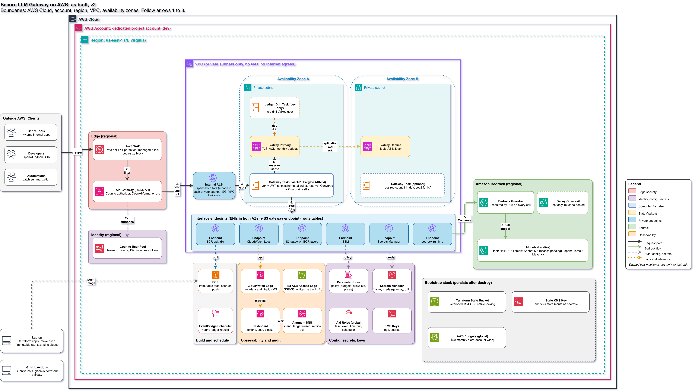

# Architecture

### How a request flows

1. **HTTPS:** an internal app or developer calls the OpenAI-compatible API with a Cognito access token.
2. **Filter:** AWS WAF blocks floods, oversized bodies, and known bad patterns.
3. **Authorize:** API Gateway checks the token with Cognito, then forwards through a private VPC Link.
4. **Route:** an internal load balancer that only accepts VPC Link traffic passes it to the gateway.
5. **Reserve:** the gateway verifies the token again, checks the model allowlist, and atomically reserves the maximum possible cost in Valkey.
6. **AWS APIs:** every AWS call leaves through a private endpoint. There is no NAT and no internet path.
7. **Converse:** Bedrock is called with the Guardrail attached. IAM denies any call without it.
8. **Call model:** the model answers, the Guardrail screens the output, and the gateway settles the real cost and logs metadata only.
